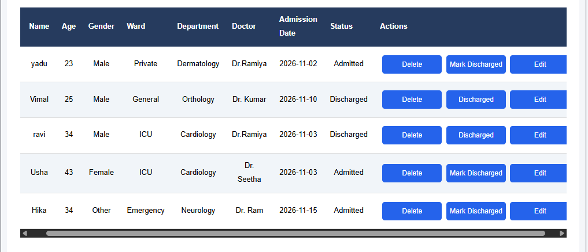
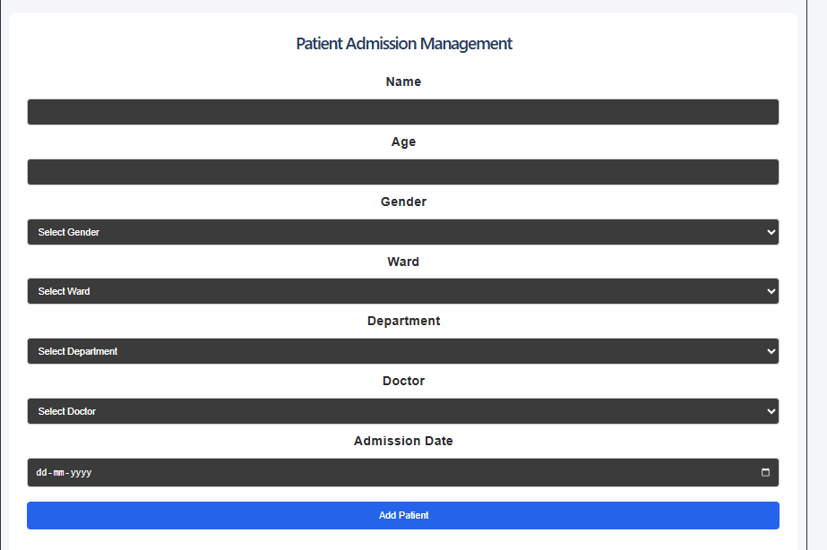
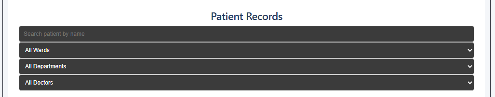

# Patient Management System

## Project Description
A web-based Patient Management System developed to manage patient information and perform basic patient operations through a user-friendly interface.

## Live Application
[Patient Management System-Live Demo](https://patient-app-frontend.vercel.app/)

## Technologies Used
- Frontend: React.js, Vite, CSS
- Backend: Python, FastAPI
- Database: SQLite (local development), PostgreSQL (production)
- ORM: SQLAlchemy
- Deployment: Vercel
- Database Hosting: Neon
- Version Control: Git and GitHub

## Features
- Add new patient records
- View all patient records
- Update patient details
- Delete patient records
- Filter patients by doctor, department and ward
- Discharge patients
- Store patient information in a database

## How to Run Locally

### Prerequisites
- Python
- Node.js and npm

### Backend Setup

```bash
cd backend
pip install -r requirements.txt
uvicorn main:app --reload
```

Backend runs at: `http://127.0.0.1:8000`

API documentation: `http://127.0.0.1:8000/docs`

### Frontend Setup

Open another terminal:

```bash
cd frontend
npm install
npm run dev
```

Frontend runs at: `http://localhost:5173`

## Screenshots

### Patient Dashboard


### Add Patient Form


### Patient Records and Filters


## Purpose
Developed as part of a technical assessment to demonstrate frontend development, backend API integration, database management and full-stack application deployment.
